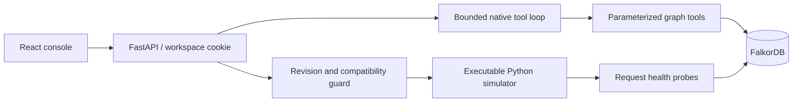

# Ripple

**Yesterday's fix can break today's system. Follow the evidence before acting.**

Ripple is a graph-backed incident investigator for a clearly labeled synthetic
commerce company. It traverses dependencies in FalkorDB, retrieves timestamped
sources and incident memory, proposes a recovery action, and verifies the result
against an executable Python simulator. Nothing touches production infrastructure.

[Public source](https://github.com/Guruchandar360/ripple-graph-hacks) ·
[Recorded showcase](https://guruchandar360.github.io/ripple-graph-hacks/) ·
[Hosted workspace](https://ripple-graph-hacks.onrender.com) ·
[Silent captioned 1080p demo](https://guruchandar360.github.io/ripple-graph-hacks/showcase/ripple-demo.mp4) ·
[CI verification](https://github.com/Guruchandar360/ripple-graph-hacks/actions) ·
[Actual measurements](docs/MEASUREMENTS.md) ·
[Proof for judges](https://guruchandar360.github.io/ripple-graph-hacks/proof/) ·
[Submission packet](docs/SUBMISSION.md)

## Current state

Implemented: React console, six-service graph fixture, three incident scenarios,
bounded native function-calling loop, graph persistence, evidence revision checks,
idempotent simulator execution, incident memory, evaluation runner, and automated tests.

The latest complete CPU measurement reached **12/12 expected outcomes** in graph
mode versus **11/12** for the full-document baseline. A separate, stricter
demonstration gate passed **3/3 consecutive sequences**, including retrieval and
citation of actual prior model outcomes. These use 300-second CPU windows,
above the normal 120-second app limit. Graph mode was slower and missed complete
impact in two cases. [Raw results and limitations](docs/MEASUREMENTS.md).

The free hosted backend passed an actual **Gemini + FalkorDB Cloud recovery**:
one model call, **7.014 seconds** of persisted investigation time, verified
503 → 200 probes, duplicate-action idempotency, memory after scenario reload,
and foreign-visitor HTTP 404. A separate native sample passed **one complete
three-scenario sequence**, with actual prior-memory citation and stale approval
rejection. This is **1/1 sampled**, not three consecutive native passes.
[Native receipts and limits](demo/live/README.md).

Google AI Studio subsequently showed the free daily limit reached (21/20
requests on October 18); further live calls may be blocked until reset. The
showcase now opens an actual Gemini replay and remains usable without model quota.

The latest demo records this interface with actual native Gemini/Cloud replays,
full explanatory captions, English subtitles and chapters; no audio track.
It includes the separate hosted receipt and CPU comparison, with their limits.
[Video provenance](demo/video.json) · [Caption and recording guide](docs/DEMO.md).

**Live investigation requires real FalkorDB and a configured model provider.**
Gemini is the default; Ollama is an explicit free local alternative. Without these,
the application offers a read-only fixture preview and connection diagnostics.
The public GitHub Pages site is a **recorded showcase**, not the live Python backend.
Recorded graphs originate in FalkorDB; exported model output is visibly labeled
Replay and cannot execute actions. See [verification](docs/VERIFICATION.md) for
actual measurements and remaining account-dependent checks.

The server defaults to `gemini-3.8-flash`. A direct official-SDK native function
call passed on October 18; the older `gemini-2.5-flash` returned 404 for this
account. The direct probe is separate from the subsequent integrated native receipts.
Google's [access policy](https://ai.google.dev/gemini-api/docs/deprecations)
limits 2.5 models to previous active users. The chosen model's standard tier
currently lists free input and output in the
[official pricing](https://ai.google.dev/gemini-api/docs/pricing).
Account quotas apply; no automatic model switch or paid fallback occurs.

The investigation workspace uses natural page scrolling at 100% zoom. A large
dependency graph leads into the timeline and recovery decision; explanations and
evidence expand to show their complete content. Inter and JetBrains Mono are
bundled locally. Tablet and phone layouts stack the panels and use a navigation
drawer. Memory, results, evidence dialogs and the checklist remain available.

## Run locally

Requirements: Python 3.12+, Node 22+, a FalkorDB server (Cloud or Docker), and a
Gemini API key with model access **or** a local Ollama server. No paid fallback is enabled.

Clone `https://github.com/Guruchandar360/ripple-graph-hacks.git` and run the following
from the repository root. Start FalkorDB with the Docker instructions below first.

### Windows PowerShell

```powershell
python -m venv .venv
.\.venv\Scripts\python -m pip install -r requirements.txt
Copy-Item .env.example .env
# Edit .env with your server-side credentials. Never put keys in frontend variables.
npm --prefix frontend ci
npm --prefix frontend run build
.\.venv\Scripts\python -m uvicorn ripple.main:app --host 127.0.0.1 --port 8000 --workers 1
```

Open <http://127.0.0.1:8000>. The API reference is at <http://127.0.0.1:8000/docs>.
The fixture preview works without a graph/model connection. Health checks report
API-key presence, not successful model authorization; the first live run verifies it.

### macOS / Linux

```sh
python3.12 -m venv .venv
.venv/bin/pip install -r requirements.txt
cp .env.example .env
npm --prefix frontend ci
npm --prefix frontend run build
.venv/bin/python -m uvicorn ripple.main:app --host 127.0.0.1 --port 8000 --workers 1
```

### FalkorDB

For Cloud, set host, port, username if required, password and `FALKORDB_SSL=true`
in `.env`. Obtain connection details from your own instance. For local Docker:

```sh
docker compose up -d
```

The graph server binds to localhost:6379, its Browser to localhost:3000. A named
volume and append-only persistence preserve data. Keep `FALKORDB_SSL=false` for
this localhost-only configuration. Docker Compose and CI pin FalkorDB **6.0.2**.

### Explicit free local model

Gemini remains the default. To run entirely locally, install Ollama and pull a
tool-capable model, then select it in `.env`:

```sh
ollama pull qwen3:4b-instruct-2507-q4_K_M
```

```dotenv
MODEL_PROVIDER=ollama
OLLAMA_HOST=http://127.0.0.1:11434
OLLAMA_MODEL=qwen3:4b-instruct-2507-q4_K_M
OLLAMA_TOOL_MODE=json
RUN_TIMEOUT_SECONDS=300
MAX_MODEL_TURNS=5
```

Keep Ollama running (`ollama serve` if its desktop service is not already active).
This selection never sends requests to Gemini, and failures never trigger a paid
fallback. CPU investigations can exceed the normal two-minute limit; for local
benchmarking explicitly set `RUN_TIMEOUT_SECONDS=300`. The CPU demonstration uses
five turns to reserve time for a structured conclusion; the default application
and comparative benchmark use eight. Document changed limits when reporting results. The real-model CI
workflow demonstrates clean Linux setup with FalkorDB and Ollama service containers.

The reproduced local configuration explicitly selects `OLLAMA_TOOL_MODE=json`.
The adapter uses Ollama's constrained JSON decoding for
the same allowlisted tool requests; the model still chooses every tool and argument.
This protocol is recorded in each run and benchmark. Gemini always uses native
function calling. `OLLAMA_TOOL_MODE=native` remains available for native local
tool calling. No provider or protocol is switched automatically.

### Frontend development

Run the Python backend on port 8000. In another terminal:

```sh
npm --prefix frontend run dev
```

Visit <http://127.0.0.1:5173>. Vite proxies `/api` to FastAPI. Build again before
viewing changes through the production server on port 8000.

## Demo flow

1. Load **Yesterday's fix** and start a graph-backed investigation.
2. Inspect the dependency paths and cited sources. The last received advisory
   permits rollback; the physical simulator independently rejects an incompatible
   action. The model may request updated evidence instead of proposing rollback.
3. Once investigation pauses, inject the migration record. Pending approvals
   become stale. Inspect the amber **Evidence changed** event and source.
4. Start a fresh investigation. Approve a justified action; inspect actual
   before/after synthetic probes. Recovery is only claimed when all affected probes pass.
5. Load **A familiar failure**. This resets simulator state, not incident memory.
   A fresh model conversation can retrieve the prior measured outcome.
6. Load **Know what you don't know**. Missing origin telemetry should produce a
   request for evidence, not an executed remediation.

The exact model investigation is not scripted and may differ between runs. There
is no hidden instruction to select a scenario's expected action. Deterministic
guards are separate from model reasoning and are visible in the event log.

## Architecture



FalkorDB is required for graph queries, run history, quotas, evidence, simulator
state and memory. Each workspace has its own graph. Simulator state is never
returned wholesale to the agent; it sees only evidence and requested probes.
Graph paths show dependency impact, not proof of root cause.

Snapshots and their labeled node/edge projections are committed in one Cypher
mutation with optimistic version checks. Simulator actions are pure transitions
followed by this commit, so a retry cannot double-execute an action. One worker
serializes workspace mutations; **do not run multiple server workers or replicas**.
This is a small hackathon implementation: rebuilding the projection on each
mutation is intentionally simple, not a large-graph scaling strategy.

See [graph model and essential Cypher](docs/GRAPH.md), [evaluation methodology](docs/EVALUATION.md),
and [demo outline](docs/DEMO.md). See `/docs` for API request/response schemas.

## Verification

```powershell
.\.venv\Scripts\python -m pytest -q
.\.venv\Scripts\python -m ruff check ripple tests
npm --prefix frontend run build
```

The default backend suite uses an explicit **test-only repository double** for
behavioral tests; the application and evaluator cannot use it. Real integration:

```powershell
$env:FALKORDB_INTEGRATION = '1'
.\.venv\Scripts\python -m pytest tests/test_integration.py -q
```

This test requires a real server, creates a unique workspace, performs actual
Cypher traversals and recovery commits, and removes its own graph afterward.
CI is configured to run this test with a FalkorDB service container.

For browser tests, use a built frontend:

```powershell
Set-Location frontend
npx playwright install chromium
npm run test:e2e
```

The browser suite checks honest preview, evidence search, missing-key diagnostics,
navigation, and responsive layout. It does not claim to test live Gemini access.
It starts its own disconnected server on port 8100 with empty credentials,
independently of `.env`, and does not reuse your live application process.

## Evaluate actual model behavior

To inspect the committed proof without model credentials or a running database,
run `python -m ripple.proof`. Add `--online` to check the cited GitHub workflow
metadata through GitHub CLI. [The judge guide](docs/PROOF.md) links each claim to
its raw record, source version, budget and limitations.

```powershell
.\.venv\Scripts\python -m ripple.evaluate --cases 1 --mode both
```

Run all 12 cases with `--cases 12`. This uses real model calls, graph storage,
and simulator actions. Full runs exceed the public demo's default ten-run daily
limit. Explicitly raise local `GLOBAL_DAILY_RUNS`, `WORKSPACE_DAILY_RUNS` and
`MAX_WORKSPACES` if account quotas permit; this does not increase Gemini's quota.
The runner stops on setup/quota failures rather than inventing results.
When evaluations share a Cloud instance with a public demo, set
`FALKORDB_CONTROL_GRAPH=ripple_evaluation_control` only in the evaluation process.
Keep the public service's control graph and normal visitor limits unchanged.

Three sequential complete demonstrations can be recorded separately with
`python -m ripple.repeat_demo --output artifacts/my-provider-sequences`.
This gate requires actual prior model outcomes to be retrieved **and cited**,
stale approval rejection, verified recovery and no insufficient-evidence execution.
For a deployed app, run `python -m ripple.http_smoke --base-url https://YOUR-APP`
to verify actual HTTP recovery, duplicate execution, persisted memory and visitor
isolation. It consumes a live investigation; use `--output` to preserve a
provider-specific report. Docker restart verification remains local-only.

Results and actual replays go into `artifacts/`. The UI reads these files. These
files are ignored by Git; reviewed public exports are committed under `demo/`,
which the API uses when no local artifacts exist. The model/API keys and raw
simulator fault configuration are not exported in replay artifacts. Each completed
case is saved immediately so later interruptions do not erase earlier results.

## Free deployment

`render.yaml` defines one free Python web service that builds and serves the
frontend. Configure the required secrets in Render, plus a free FalkorDB instance
if available. `COOKIE_SECURE=true` is required on the HTTPS deployment. The daily
live-run and workspace limits bound the public demo; they are not billing controls.

The selected Free database uses plaintext Redis, explicitly approved by the
participant for this synthetic demo only. Its password and synthetic records
travel without TLS between the app and FalkorDB. Browser and Gemini requests
use HTTPS. The deployment template keeps TLS enabled by default; only the
selected demo instance uses `FALKORDB_SSL=false`. Do not use this exception
for real incidents or sensitive data.

Render's free instance can sleep. A new visitor may see a cold start before the
app loads. All live state is in FalkorDB, not Render's ephemeral filesystem.
Restarted investigations are marked interrupted on startup; actions are never
automatically repeated. The hosted native verification is recorded separately
in `demo/live/`; account quota can still prevent a new investigation.

The separate GitHub Pages workflow builds a static, read-only showcase after
browser checks. It exposes synthetic recordings and results, has no credentials,
and cannot start investigations or execute recoveries. To reproduce that build:

```powershell
.\.venv\Scripts\python -m ripple.export_showcase
$env:VITE_STATIC_SHOWCASE = 'true'
$env:VITE_BASE_PATH = '/ripple-graph-hacks/'
npm --prefix frontend run build
Remove-Item Env:VITE_STATIC_SHOWCASE, Env:VITE_BASE_PATH
```

Rebuild without those variables before running the full local backend.

Public visitors can create up to 30 persisted workspaces by default. This is a
capacity cap, not an automatic retention policy; increase it deliberately or
clean up your own expired demonstration workspaces through FalkorDB Browser.

## Hackathon submission

Primary: **Agents That Act on Connected Data**. Also relevant: Company Brain
and Agent Memory and Coordination through provenance, ownership and memory.

Provide a public repository URL, live deployment or complete local instructions,
working demo video, graph model, actual Cypher, and measured results. Every fixture
is synthetic. The participant must review and understand the code, architecture,
queries and technical decisions before submitting. See the [official-rules audit](docs/COMPLIANCE.md)
and [participant technical guide](docs/CONTRIBUTOR_GUIDE.md). Registration and the
organizer's final submission form are not automatically completed by this repository.

**AI assistance disclosure:** Codex generated and revised implementation code,
tests, styling, and documentation with AI assistance. Automated tests cover selected
behaviors; actual provider/database integration and benchmark results must be
verified in the configured environment. Record your own review and contributions
in the final submission rather than claiming work or checks you did not perform.
