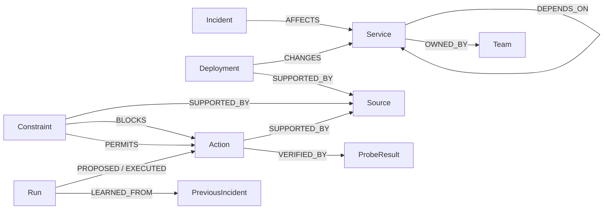

# Graph model and essential queries



All projected nodes also carry `Entity`, a stable `id`, and a JSON `data` property.
Source JSON includes effective/ingestion timestamps and `active`. Historical,
superseded records remain present but are excluded from active tools. Incident
memory records store success **or failure** plus applicability notes.

`Workspace` holds the durable revisioned snapshot, including private simulator
configuration. Tools do not expose this node. `ripple_control` separately stores
Visitor registrations, Capacity, and UTC-date Usage records. Graph names are
server-generated, validated 32-character hexadecimal workspace identifiers.

## Incoming dependency impact

Actual query used by `get_impact` and action verification:

```cypher
MATCH p=(s:Service)-[:DEPENDS_ON*0..5]->(t:Service {id:$target})
RETURN s.id,
       [n IN nodes(p) | n.id],
       [r IN relationships(p) | r.id]
```

For payments, the base fixture yields payments, checkout, and storefront, with
actual relationship IDs returned for UI highlighting. The zero-length path
includes the target. Five hops bound traversal over the six-service fixture.

## Ownership and source evidence

```cypher
MATCH (s:Service)-[:OWNED_BY]->(t:Team)
RETURN s.id, t.data
```

```cypher
MATCH (s:Source) RETURN s.data
```

Active filtering occurs on decoded evidence records in the context tool. The
baseline uses the same active documents but cannot call ownership/traversal tools.

## Incident memory

```cypher
MATCH (i:Incident)-[:AFFECTS]->(s:Service)
WHERE i.id STARTS WITH 'memory-' AND ($target='' OR s.id=$target)
RETURN i.data
```

This retrieves persisted outcomes independently of prior conversation messages.
The agent must still inspect current evidence and probe before proposing reuse.

## Current action policies

```cypher
MATCH (c:Constraint)-[r:BLOCKS|PERMITS]->(a:Action)
MATCH (c)-[:SUPPORTED_BY]->(s:Source)
WHERE c.active=true AND a.template=true
RETURN c.data, s.id
```

This query is used by both proposal validation and execution. Typed synthetic
source records project explicit policies into native graph relationships.
An action/target filter is applied to the returned policies. A block takes
precedence; rollback also requires an explicit current permit. The model cannot
create or alter these policies through its tools.

Records with the same `fact_key` are resolved by effective timestamp, independently
of ingestion order. Superseded sources and policies remain inspectable but cannot
authorize a current action. Equal timestamps use a deterministic ID tie-break;
this is not a complete production conflict-resolution or trust system.

## Atomic mutation

The repository builds a single allowlisted query to compare snapshot version,
replace the projected entities/relationships, and save the next snapshot. Node
and relationship labels come from code allowlists; property values are parameters.

```cypher
MERGE (w:Workspace {id:'root'}) ON CREATE SET w.version=0
WITH w WHERE w.version=$expected
OPTIONAL MATCH (e:Entity) DETACH DELETE e
WITH DISTINCT w SET w.version=$version, w.payload=$payload
// Parameterized CREATE clauses project the next snapshot here.
RETURN w.version
```

Evidence revision is separate from storage version: model progress increments
storage version, while scenario changes, migration ingestion, and executed actions
also invalidate outstanding approvals through evidence revision/generation checks.
Simulator state and execution results commit together. No external side effect
exists outside this simulator transaction.
